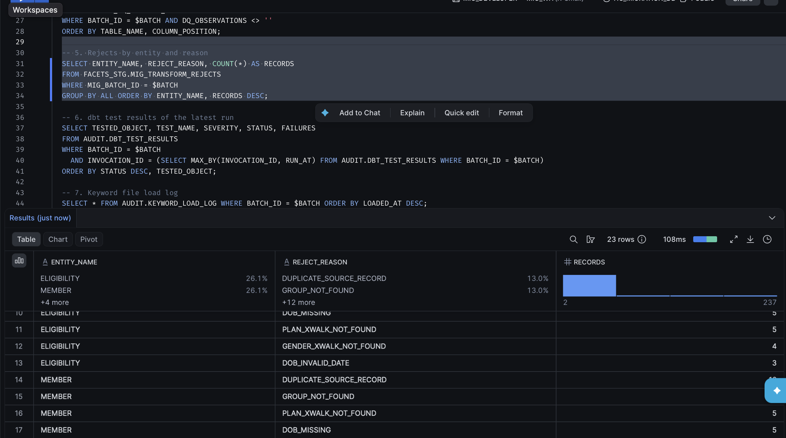
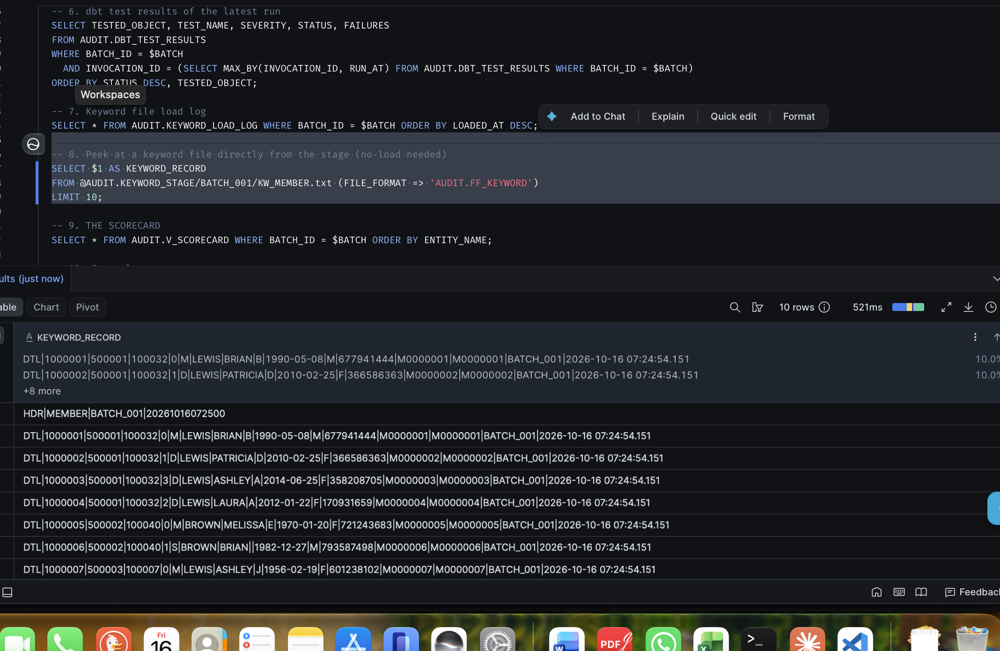
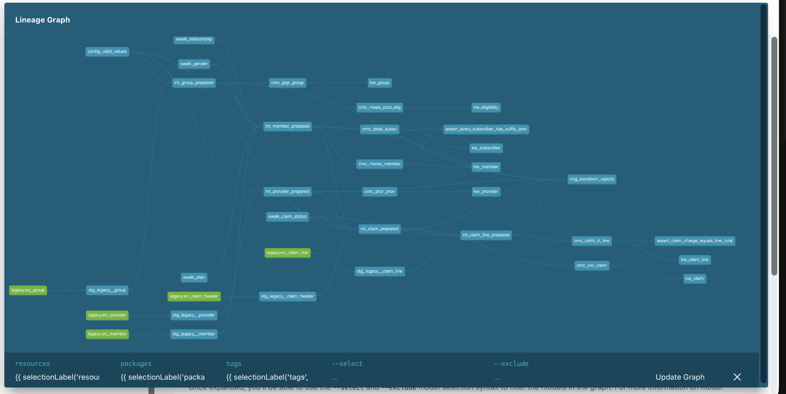

# Healthcare Payer Data Migration on Snowflake + dbt

End-to-end **data conversion pipeline** that migrates legacy US healthcare payer extracts
(groups, members, providers, claims) into a **Facets-like target**, rebuilt on
**Snowflake** and **dbt Core**.

It follows the same workflow used on real payer conversion projects:

> **source extracts → data profiling → client profiling report → transformation (mapping document) →
> pre-load validation → keyword (load) file → load to target → reconciliation scorecard**

All data is **synthetic** (generated by `scripts/generate_source_data.py`). No real members, providers or PHI.

---

## Architecture

```mermaid
flowchart LR
    subgraph SRC["Client extracts"]
        F["SRC_*.txt<br/>pipe-delimited"]
    end
    subgraph SF["Snowflake  ·  HC_MIGRATION_DB"]
        STG1["@RAW.SRC_STAGE<br/>internal stage"]
        RAW["RAW<br/>landing tables (all VARCHAR)"]
        PROF["AUDIT.DQ_PROFILE_RESULTS<br/>+ client report CSV"]
        subgraph DBT["dbt Core"]
            REF["REF<br/>crosswalk seeds"]
            STGV["STAGING<br/>cleanse + type"]
            INT["INTERMEDIATE<br/>rules, rejects, keys"]
            FST["FACETS_STG<br/>Facets-like tables"]
            REJ["MIG_TRANSFORM_REJECTS"]
            TEST{{"validation gate<br/>dbt tests"}}
            KW["KEYWORD<br/>HDR / DTL / TRL"]
        end
        KWS["@AUDIT.KEYWORD_STAGE<br/>KW_*.txt"]
        TGT["FACETS_TGT<br/>target environment"]
        SC["AUDIT.MIGRATION_SCORECARD<br/>+ MIGRATION_ERROR_LOG"]
    end
    F -- "upload" --> STG1 -- "SP_LOAD_RAW<br/>COPY INTO" --> RAW
    RAW -- "SP_PROFILE_ALL" --> PROF
    RAW --> STGV --> INT
    REF --> INT
    INT --> FST
    INT --> REJ
    FST --> TEST --> KW -- "post-hook<br/>COPY INTO @stage" --> KWS
    KWS -- "SP_LOAD_FACETS_TARGET" --> TGT
    TGT -- "SP_BUILD_SCORECARD" --> SC
    REJ --> SC
```



### What does what

| Migration step | SQL Server version (day job) | This project |
|---|---|---|
| Receive source extracts | Files on a share | Upload to Snowflake **internal stage** `@RAW.SRC_STAGE/<batch>/` |
| Load to temp tables | BULK INSERT / temp tables | **Stored procedure** `SP_LOAD_RAW`: metadata-driven `COPY INTO` with lineage columns |
| Data profiling (null, min/max, invalid characters) | Ad-hoc queries | **Stored procedure** `SP_PROFILE_ALL`: dynamic SQL per column → `DQ_PROFILE_RESULTS` |
| Profiling report to client | Excel by hand | `COPY INTO @AUDIT.REPORT_STAGE` unloads `DQ_PROFILE_REPORT.csv` |
| Transformation from mapping document | Stored procedures | **dbt models** `staging → intermediate → facets_stg` + crosswalk **seeds** |
| Facets-lookalike tables | Staging tables | dbt tables in `FACETS_STG` (`CMC_GRGR_GROUP`, `CMC_MEME_MEMBER`, ...) |
| Pre-load validation (duplicates, recon, config values) | Validation scripts | **dbt tests** as a gate: `unique`, `relationships`, `values_in_config`, `reconciles_with_source`, ... |
| Generate the keyword (load file) | Export job | dbt `kw_*` models + post-hook `COPY INTO @AUDIT.KEYWORD_STAGE` |
| Core job loads Facets | Facets batch job | **Stored procedure** `SP_LOAD_FACETS_TARGET`: header/trailer checks, transactional load |
| Scorecard: source vs target counts, warnings | Excel / SQL | **Stored procedure** `SP_BUILD_SCORECARD` → `MIGRATION_SCORECARD`, `MIGRATION_ERROR_LOG` |
| Scheduling | SQL Agent jobs | **Snowflake Tasks** (DAG) + `run_pipeline` script / GitHub Actions |
| PHI protection | DB permissions | **RBAC roles** + **dynamic data masking** |
| Recovery / test environments | Backup & restore | **Time Travel**, **UNDROP**, **zero-copy cloning** |

**Why hybrid (procedures + dbt)?** Set-based transformations and data tests belong in dbt: they are
version-controlled, tested and documented with lineage. Procedural, operational work (loading files,
profiling every column with dynamic SQL, file-level header/trailer checks, scorecards) stays in
Snowflake Scripting stored procedures, which is also what most migration teams already run.

---

## The data

`scripts/generate_source_data.py` creates one batch of legacy extracts (~28,000 rows) and deliberately
injects the kind of problems real client data has:

| Injected problem | Where it's caught | Outcome |
|---|---|---|
| NULL / invalid DOB (`02/30/1985`, `1988-07-14`) | profiling, source test, reject rule | rejected |
| Accented / control characters in names (`José`, tab) | profiling, `no_invalid_characters` | cleansed (`JOSE`) |
| Legacy gender codes `1` / `2` | crosswalk seed | mapped to M / F |
| Unmapped gender `X`, unmapped plan `P999` | crosswalk lookup | rejected |
| SSN with dashes / garbage | profiling, `matches_regex` | cleansed / nulled + warning |
| Members pointing at a group that doesn't exist | `relationships` test, reject rule | subscriber + all dependents rejected |
| Exact duplicate member rows | profiling, `unique` | 2nd copy rejected |
| Provider with invalid state `XX` | config check | provider rejected → its claims rejected |
| NPI with wrong length | `matches_regex` (warn) | loaded with warning |
| Claim for unknown member, from-date after to-date, unknown status | reject rules | rejected |
| Orphan claim lines, negative paid amounts | reject rule / warn test | rejected / warning |

The full list with counts is written to `data/source/BATCH_001/_injected_issues.json`, so you can prove
the pipeline caught every single one.

---

## Repository structure

```
snowflake-healthcare-data-migration/
├── README.md
├── requirements.txt                    dbt-core + dbt-snowflake
├── data/source/BATCH_001/              synthetic source extracts (+ _injected_issues.json)
├── scripts/
│   ├── generate_source_data.py         synthetic data generator (standard library only)
│   └── generate_keypair.py             RSA key pair for dbt key-pair authentication
├── sql/                                run in Snowsight, in this order
│   ├── 00_setup/                       roles, warehouse, database, schemas, stages,
│   │                                   control/audit tables, masking policies, dbt service user
│   ├── 01_raw_load/                    RAW tables + SP_LOAD_RAW
│   ├── 02_profiling/                   SP_PROFILE_SOURCE, SP_PROFILE_ALL, V_DQ_PROFILE_REPORT
│   ├── 03_target_load/                 SP_LOAD_FACETS_TARGET (keyword file loader)
│   ├── 04_scorecard/                   SP_BUILD_SCORECARD, V_SCORECARD, V_ERROR_SUMMARY
│   ├── 05_orchestration/               SP_RUN_STEP + Snowflake Tasks DAG
│   ├── 06_security_and_recovery/       masking demo, Time Travel / UNDROP / clone demo
│   └── 07_queries/                     handy queries for checking a batch
├── dbt/
│   ├── dbt_project.yml                 layers → schemas, vars, test-results hook
│   ├── profiles.yml.example            copy to ~/.dbt/profiles.yml
│   ├── seeds/                          crosswalks + config valid values
│   ├── models/staging/                 sources (+ warn-level source tests) and cleansing views
│   ├── models/intermediate/            business rules, reject reasons, contrived keys
│   ├── models/facets_stg/              Facets-like tables, rejects, validation tests
│   ├── models/keyword/                 keyword file records + unload post-hooks
│   ├── macros/                         cleansing, keyword file, masking, procedure calls, test logging
│   └── tests/                          custom generic tests + singular business-rule tests
├── orchestration/run_pipeline.{sh,ps1} one command to run the whole batch
├── streamlit/migration_dashboard.py    optional Streamlit dashboard (see Future enhancements)
├── docs/
│   ├── SETUP_GUIDE.md                  step-by-step: trial account → first scorecard
│   ├── INTERVIEW_GUIDE.md              how to explain the project + likely questions
│   └── mapping_document.xlsx           source-to-target mapping + reject rules
└── .github/workflows/                  CI (dbt parse) + on-demand pipeline run
```

---

## Quick start

Full beginner-friendly instructions are in **[docs/SETUP_GUIDE.md](docs/SETUP_GUIDE.md)**. Short version:

```bash
# 1. Snowflake: run sql/00_setup/01..04 in Snowsight, then sql/01..05 (in order)
# 2. Upload data/source/BATCH_001/SRC_*.txt to @HC_MIGRATION_DB.RAW.SRC_STAGE/BATCH_001/
# 3. Local machine
python3.12 -m venv .venv && source .venv/bin/activate # Windows: py -3.12 -m venv .venv; .venv\Scripts\activate
pip install -r requirements.txt
python scripts/generate_keypair.py                    # then run sql/00_setup/05_dbt_service_user.sql
cp dbt/profiles.yml.example ~/.dbt/profiles.yml        # set SNOWFLAKE_ACCOUNT + SNOWFLAKE_PRIVATE_KEY_PATH
cd dbt && dbt deps && dbt debug && cd ..
# 4. Run the whole batch
bash orchestration/run_pipeline.sh BATCH_001          # Windows: .\orchestration\run_pipeline.ps1
```

Then in Snowsight:

```sql
SELECT * FROM HC_MIGRATION_DB.AUDIT.V_SCORECARD     WHERE BATCH_ID = 'BATCH_001';
SELECT * FROM HC_MIGRATION_DB.AUDIT.V_ERROR_SUMMARY WHERE BATCH_ID = 'BATCH_001';
```

Every entity should show `SOURCE_RECON_STATUS = BALANCED` and `TARGET_RECON_STATUS = MATCH`,
with rejects and warnings explained in the error log.

---

## Key design decisions

- **RAW is all VARCHAR and transient.** Nothing is lost on load; typing happens after profiling. Transient
  tables avoid fail-safe storage cost for data that can be reloaded from the stage.
- **Every source row is accounted for.** Intermediate models return every row with a `reject_reason`
  (NULL = accepted). `FACETS_STG` gets the accepted rows, `MIG_TRANSFORM_REJECTS` the rest, so
  **source = staged + rejected** is testable (`reconciles_with_source`) and appears on the scorecard.
- **Rejects cascade.** A rejected group rejects its subscribers, a rejected subscriber rejects its
  dependents, a rejected member or provider rejects their claims, a rejected claim rejects its lines,
  exactly like referential rules in the target system.
- **Reject vs. warning.** Rules that would corrupt the target reject the record; rules the business agreed
  to "load and report" (missing SSN, bad NPI length, negative paid line) are warnings.
- **Validation gate.** Pre-load tests on `FACETS_STG` are `severity: error`. If one fails, `dbt build` skips
  the keyword model for that entity, no file is produced, and the target load logs it, so bad data never
  reaches the target. Old keyword files are cleared at the start of every run.
- **Keyword files have header + trailer.** The loader rejects a file whose trailer count doesn't match its
  detail records, and loads each entity in a single transaction (delete batch + insert).
- **Metadata-driven procedures.** Files to load and entities to reconcile come from
  `AUDIT.MIG_SOURCE_FILE_CONFIG` and `AUDIT.MIG_ENTITY_CONFIG`; adding an entity means adding a row.
- **Re-runnable.** Every step deletes its own batch output first; batches are tracked in `MIG_BATCH_CONTROL`.
- **Security.** Four roles in a hierarchy; SSN, DOB and names are masked by policy for QA / analyst
  roles; dbt connects as a key-pair **service user**, never with a personal password.
- **Cost.** X-Small warehouse, 60-second auto-suspend, resource monitor capped at 10 credits a month.

---

## Results (BATCH_001)

The full pipeline was run end to end on a Snowflake trial account (AWS, Mumbai).

**dbt build:** 117 nodes, `PASS=104 WARN=13 ERROR=0`. The 13 warnings are the data-quality
problems injected on purpose (invalid dates, bad SSNs, accented names, orphans, bad NPIs, negative
paid lines). They are reported but do not block the load.

**Reconciliation scorecard** (`AUDIT.V_SCORECARD`):

| Entity | Source | Rejected | Staged = Keyword = Target | Load % | Recon |
|---|---:|---:|---:|---:|---|
| GROUP | 60 | 0 | 60 | 100.00 | BALANCED / MATCH |
| SUBSCRIBER | 1,505 | 9 | 1,496 | 99.40 | BALANCED / MATCH |
| MEMBER | 3,938 | 36 | 3,902 | 99.09 | BALANCED / MATCH |
| ELIGIBILITY | 3,938 | 36 | 3,902 | 99.09 | BALANCED / MATCH |
| PROVIDER | 350 | 3 | 347 | 99.14 | BALANCED / MATCH |
| CLAIM | 8,000 | 125 | 7,875 | 98.44 | BALANCED / MATCH |
| CLAIM_LINE | 15,962 | 240 | 15,722 | 98.50 | BALANCED / MATCH |

Every source row is either loaded or rejected with a reason. Not one record is unaccounted for.

**Member reject report** (`FACETS_STG.MIG_TRANSFORM_REJECTS`): each reason traces back to an injected issue.

| Reject reason | Records |
|---|---:|
| DUPLICATE_SOURCE_RECORD | 10 |
| GROUP_NOT_FOUND (subscriber + dependents) | 9 |
| PLAN_XWALK_NOT_FOUND | 5 |
| DOB_MISSING | 5 |
| GENDER_XWALK_NOT_FOUND | 4 |
| DOB_INVALID_DATE | 3 |
| **Total** | **36** |

**Resilience test: a missing crosswalk value.** The legacy gender code `1 → M` was removed from
`dbt/seeds/xwalk_gender.csv` and the pipeline re-run:

| Entity | Rejected before | Rejected after | Recon |
|---|---:|---:|---|
| SUBSCRIBER | 9 | 12 | BALANCED |
| MEMBER / ELIGIBILITY | 36 | 45 | BALANCED |
| CLAIM | 125 | 145 | BALANCED |
| CLAIM_LINE | 240 | 276 | BALANCED |

The affected members were rejected with `GENDER_XWALK_NOT_FOUND`, their dependents, claims and
claim lines cascaded with traceable reasons, and every entity still balanced. The load did not fail
and no data went missing. Restoring the one-line crosswalk entry and re-running brought the numbers back.

### Screenshots

**Reconciliation scorecard**


**Reject report**



**Keyword (load) file: HDR / DTL records**



**dbt lineage graph: sources → staging → intermediate → Facets-like tables → keyword files**



---

## Future enhancements

- Streamlit in Snowflake dashboard over the scorecard and error log (a first version is in
  `streamlit/migration_dashboard.py`).
- Land source files from **Amazon S3** through an external stage + storage integration (and Snowpipe for
  automatic ingestion).
- Run dbt inside Snowflake with **dbt Projects on Snowflake** so the whole pipeline is one task graph.
- **Incremental / delta loads** for post-conversion daily files using Streams and dbt incremental models.
- Tag-based masking and row access policies by line of business.
- Second batch (`--batch BATCH_002`) with changed records to demonstrate re-conversion.

---

*Personal learning project. Table and column names are modelled on publicly known Facets naming
conventions; this project is not affiliated with or endorsed by any software vendor or employer.*
